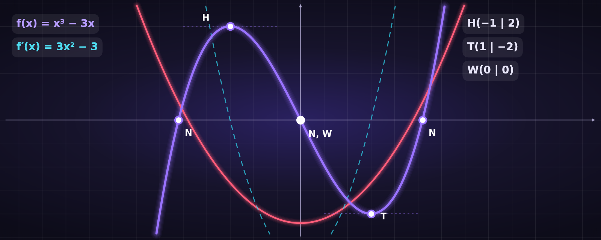

<p align="center">
  
</p>

<h1 align="center">Kurverafx</h1>

<p align="center"><em>created by Daniel Kiebler</em></p>

<p align="center">
  
  
  
  
  
</p>

---

## Table of Contents

1. [Overview](#overview)
2. [Features](#features)
3. [Installation](#installation)
4. [Usage](#usage)
5. [Input Syntax](#input-syntax)
6. [Worked Example](#worked-example)
7. [Project Documentation](#project-documentation)
   - [Technical Facts](#technical-facts)
   - [Architecture](#architecture)
   - [APK Structure](#apk-structure)
   - [Mathematical Methods](#mathematical-methods)
   - [Graph Rendering & Interaction](#graph-rendering--interaction)
   - [Analysis Output](#analysis-output)
   - [Privacy & Security](#privacy--security)
   - [Limitations](#limitations)
   - [Modifying the App](#modifying-the-app)
   - [Roadmap Ideas](#roadmap-ideas)
8. [License](#license)
9. [Author](#author)

---

## Overview

**Kurverafx** is a lightweight Android app for **curve sketching** (German: *Kurvendiskussion*) of polynomial functions. Enter a function such as `x^3 - 3x`, and the app instantly:

- plots it on an interactive, zoomable coordinate system, and
- shows a **step-by-step analysis** (derivatives, roots, extrema, inflection points, monotonicity) together with the calculated results.

The whole app is only **~16 KB**, works **completely offline**, and requires **no permissions**.

> **Note:** The user interface and the generated analysis text of the app are in German (e.g. *Nullstellen* = roots, *Extremstellen* = extrema, *Wendestellen* = inflection points, *Monotonie* = monotonicity). This documentation is written in English; a glossary is included below.

### Glossary (German UI → English)

| German term in the app | English meaning |
|---|---|
| Kurvendiskussion | Curve sketching / function analysis |
| Funktionen | Functions |
| Rechenweg & Kurvendiskussion | Calculation steps & curve analysis |
| Ausgangsfunktion | Original function |
| Ableitungen | Derivatives |
| Achsenschnittpunkte | Axis intercepts |
| Nullstellen | Roots / zeros |
| y-Achsenabschnitt | y-intercept |
| Extremstellen | Extrema |
| Hochpunkt / Tiefpunkt | Local maximum / local minimum |
| Stationärer Punkt | Stationary point (f′ = 0, no sign change confirmed by f″) |
| Wendestellen / Wendepunkte | Inflection points |
| Monotonie | Monotonicity |
| Steigend / Fallend / Konstant | Increasing / decreasing / constant |
| Abszisse / Ordinate | x-axis / y-axis |

---

## Features

- 📈 **Interactive graph** – pan, pinch-to-zoom, zoom buttons, reset view
- 🧮 **Full curve sketching** – roots, y-intercept, extrema, inflection points, monotonicity
- 🧾 **Transparent calculation path** – derivatives *f′*, *f″*, *f‴* are shown, along with the conditions that were checked
- 🎯 **Automatic point markers** on the graph: `N` (root), `Y` (y-intercept), `H` (maximum), `T` (minimum), `S` (stationary point), `W` (inflection point) – can be toggled on/off
- ➕ **Multiple functions at once** – each in its own colour (`f`, `g`, `h`, …); select one to analyse it
- 🔢 **Polynomials up to degree 12**
- ⌨️ **Forgiving input** – supports `²`, `³`, `⁴`, Unicode minus, decimal comma, optional `*`, optional `y=` / `f(x)=` prefix
- 📴 **100% offline** – no internet, no tracking, no permissions
- 🌙 **Modern dark UI** – responsive layout (single column on phones, two columns on wide screens/tablets)
- 🪶 **Tiny footprint** – ~16 KB APK

---

## Installation

### Requirements

- Android **8.0 (API 26)** or newer

### Steps

1. Download the APK file (`Kurverafx.apk`) to your Android device.
2. Open the file. If prompted, allow installation from this source ("Install unknown apps").
3. Confirm the installation.
4. Launch **Kurverafx** from your app drawer.

> Only install APK files from sources you trust.

---

## Usage

1. **Enter a function** in the input field, e.g. `x^3 - 3x`, and tap **+** (or press *Enter*).
2. The function is added to the list and drawn on the graph.
3. Tap **Analyse** next to a function to display its full curve discussion below the graph.
4. **Navigate the graph:**
   - *Drag* with one finger to move the view
   - *Pinch* with two fingers to zoom (zooms around the finger centre)
   - **+ / −** buttons to zoom in/out
   - **⌂** to reset the view
   - *Mouse wheel* zooms when used on a desktop browser/emulator
5. Toggle **"Nullstellen, Extrempunkte und Wendepunkte markieren"** to show or hide the point markers.
6. Remove a function with **✕**.

On first launch, two example functions are preloaded: `f(x) = x³ − 3x` and `g(x) = x² − 4`.

---

## Input Syntax

Kurverafx accepts **polynomials** (ganzrationale Funktionen) in the variable `x`.

| Rule | Example |
|---|---|
| Terms with `x`, numbers and non-negative integer powers | `2x^4 - 3x^2 + 5` |
| Power with `^` or Unicode superscripts `²` `³` `⁴` | `x^3`, `x³`, `2x²` |
| Implicit coefficient 1 | `x^2 - x` |
| Decimal numbers (dot **or** comma) | `0.5x^2`, `0,5x^2` |
| Optional `*` between coefficient and `x` (ignored) | `2*x^3` |
| Optional prefix `y=` or `f(x)=` (any single letter) | `y = x^2 - 4`, `f(x)=x^3` |
| Spaces are ignored | `x ^ 3 - 3 x` |
| Unicode minus `−` is accepted | `x² − 4` |
| Constants | `5` |
| **Maximum degree: 12** | `x^12 + 1` |

**Not supported:** parentheses/products like `(x+1)(x-2)`, fractions, roots, trigonometric, exponential or logarithmic functions. In that case the app shows an error message below the input field (e.g. *"Nur Polynome mit x, Zahlen und Potenzen eingeben."*).

---

## Worked Example

Input: `x^3 - 3x`

| Step | Result |
|---|---|
| Function | f(x) = x³ − 3x |
| Derivatives | f′(x) = 3x² − 3, f″(x) = 6x, f‴(x) = 6 |
| Roots | x = −1.73205, x = 0, x = 1.73205 (±√3) |
| y-intercept | (0 \| 0) |
| Extrema | **H**(−1 \| 2) – local maximum, **T**(1 \| −2) – local minimum |
| Inflection point | **W**(0 \| 0) |
| Monotonicity | increasing on (−∞; −1), decreasing on (−1; 1), increasing on (1; +∞) |

---

## Project Documentation

### Technical Facts

| Property | Value |
|---|---|
| App name | Kurverafx |
| Package name | `de.kurverafx.app` |
| Version | `1.0` (versionCode `1`) |
| Minimum SDK | 26 (Android 8.0) |
| Target SDK | 36 |
| Main activity | `de.kurverafx.app.MainActivity` (launcher activity) |
| Permissions | **none** |
| Cleartext network traffic | disabled |
| App type | Hybrid app: native Android `WebView` shell + HTML/CSS/JavaScript |
| UI language | German |
| Approx. APK size | 16 KB |
| Third-party libraries | **none** (pure vanilla JavaScript, Canvas 2D) |

### Architecture

Kurverafx follows a deliberately minimal architecture:

```
┌──────────────────────────────────────────────┐
│                Android (Java)                │
│  MainActivity                                │
│   └─ WebView                                 │
│        • JavaScript enabled                  │
│        • DOM storage enabled                 │
│        • loads file:///android_asset/       │
│          index.html                          │
└──────────────────────┬───────────────────────┘
                       │
┌──────────────────────▼───────────────────────┐
│          assets/index.html (single file)     │
│                                              │
│  UI layer        HTML + CSS (dark theme,     │
│                  responsive grid)            │
│  Parser          text → coefficient array    │
│  Math core       evaluate, derive, roots     │
│  Analysis        extrema, inflection,        │
│                  monotonicity                │
│  Renderer        <canvas> 2D, grid, curves,  │
│                  markers, pan/zoom gestures  │
└──────────────────────────────────────────────┘
```

- **Native layer:** `MainActivity` creates a `WebView`, applies the dark background colour, enables JavaScript and DOM storage, and loads the bundled `index.html` from the app's assets.
- **Web layer:** The entire application logic and UI live in a single self-contained `index.html` (HTML, CSS and JavaScript inline). There are no external requests, CDNs or fonts – the system font stack is used.

**Internal data model:** a polynomial is stored as a coefficient array indexed by power, e.g. `x³ − 3x` → `[0, -3, 0, 1]` (`c[i]` is the coefficient of `xⁱ`). All operations (evaluation, differentiation, root finding) work on this array.

### APK Structure

```
Kurverafx.apk
├── AndroidManifest.xml      # package, SDK levels, launcher activity
├── classes.dex              # MainActivity (WebView setup)
├── resources.arsc           # app_name string resource
├── assets/
│   └── index.html           # complete app: UI + math + rendering
└── META-INF/                # APK signature files
```

### Mathematical Methods

All calculations are performed with double-precision floating point numbers.

#### 1. Parsing

1. Normalisation: superscripts `²³⁴` → `^2 ^3 ^4`, Unicode minus → `-`, `,` → `.`, whitespace and `*` removed, optional `y=` / `f(x)=` prefix stripped.
2. Validation: only the characters `0–9 x + - . ^` are allowed.
3. The string is split into signed terms. Each term is matched against `[sign][number][x[^power]]`.
4. Coefficients of equal powers are summed; trailing zero coefficients are trimmed; degrees above 12 are rejected.

#### 2. Evaluation and differentiation

- **Evaluation** uses **Horner's method** (numerically stable, `O(n)`).
- **Derivative:** `c'[i-1] = i · c[i]` – applied up to three times (*f′*, *f″*, *f‴*).

#### 3. Real root finding

The `roots(c)` function uses **recursive derivative isolation**:

1. Compute the roots of the derivative recursively (they are the critical points where the polynomial can change direction). Degree 1 is solved directly: `x = −c₀ / c₁`.
2. Compute a root bound `B = 1 + max(|cᵢ|) / |cₙ|` (capped at 10⁷). All real roots lie within `[−B, B]`.
3. Use `−B`, the critical points, and `+B` as interval boundaries. Within each interval the polynomial is monotonic, so **at most one root** exists there.
4. If the function values at both ends of an interval have opposite signs, the root is located with **bisection** (up to 90 iterations, tolerance 10⁻¹⁰).
5. Critical points where `|f(x)|` is practically zero (< 10⁻⁶ · max(1, |cₙ|)) are added as roots – this finds **even-multiplicity roots** (touching points) that bisection alone would miss.
6. Results are sorted and de-duplicated (tolerance 10⁻⁵).

#### 4. Extrema

- Necessary condition: **f′(x) = 0** → candidates via `roots(f′)`.
- Classification with the second derivative:
  - `f″(x) > 10⁻⁷` → **local minimum (Tiefpunkt)**
  - `f″(x) < −10⁻⁷` → **local maximum (Hochpunkt)**
  - otherwise → **stationary point** (further checking required, e.g. saddle point)

#### 5. Inflection points

- Necessary condition: **f″(x) = 0** → candidates via `roots(f″)`.
- A candidate counts as an inflection point only if **f″ changes sign** around it (checked at `x ± h`, with `h = max(10⁻⁴, |x| · 10⁻⁵)`).

#### 6. Monotonicity

The real line is divided at the extremum x-values. The sign of **f′** is tested at a representative point in each interval and reported as *increasing*, *decreasing* or *constant*.

### Graph Rendering & Interaction

- **Canvas 2D** rendering, scaled for the device pixel ratio (sharp on HiDPI screens).
- **Adaptive grid:** the grid step is chosen automatically (1-2-2.5-5 pattern in powers of ten) so lines stay readable at every zoom level; axis labels are formatted with the German number format.
- **Curve drawing:** sampled every 1.5 px; discontinuity/overflow guards prevent spurious vertical lines for very steep or very large values.
- **Selected function** is drawn slightly thicker.
- **View model:** `{ cx, cy, scale }` – centre of the view in world coordinates and pixels per unit. Zoom range: `0.001` to `100 000` px/unit.
- **Gestures** are implemented with the Pointer Events API:
  - 1 pointer → pan
  - 2 pointers → pinch-zoom anchored at the midpoint between the fingers
  - mouse wheel → zoom
- **Colour palette:** 8 colours, cycled for additional functions. Functions are labelled `f`, `g`, `h`, … in order.

**Marker legend**

| Marker | Meaning |
|---|---|
| `N` | Root (Nullstelle) |
| `Y` | y-intercept |
| `H` | Local maximum (Hochpunkt) |
| `T` | Local minimum (Tiefpunkt) |
| `S` | Stationary point (Sattel-/stationärer Punkt) |
| `W` | Inflection point (Wendepunkt) |

### Analysis Output

For the selected function, the app shows six sections:

1. **Original function** – normalised polynomial
2. **Derivatives** – *f′*, *f″*, *f‴*
3. **Axis intercepts** – roots and y-intercept
4. **Extrema** – candidates, classification via *f″*
5. **Inflection points** – candidates with sign-change check
6. **Monotonicity** – increasing/decreasing intervals

Numbers are rounded to 5 decimal places and displayed in German locale (decimal comma).

### Privacy & Security

- Declares **no Android permissions** – in particular no `INTERNET` permission.
- **No analytics, no ads, no tracking, no accounts.**
- All computation happens locally on the device.
- Cleartext (HTTP) traffic is disabled.
- User input is rendered via `textContent` (not as HTML), which avoids HTML injection through the function input.

### Limitations

- Only **polynomials** (degree ≤ 12) are supported – no rational, trigonometric, exponential or logarithmic functions, and no parentheses.
- Numerical methods use floating-point arithmetic. For high-degree polynomials with very large coefficients or closely spaced / high-multiplicity roots, results are approximations.
- Roots are real-valued only; complex roots are not reported.
- Not included (yet): symmetry analysis, end behaviour/limits, concavity intervals, tangent/normal lines, function table, export of results.
- The UI is currently available in German only.

### Modifying the App

Because the application logic is contained in a single HTML file, it is straightforward to adapt:

1. Unpack the APK (e.g. with `apktool d Kurverafx.apk`).
2. Edit `assets/index.html` (UI texts, colours, logic).
3. Re-build and sign the APK (`apktool b`, then sign with `apksigner`).
4. Install the result on your device.

> Tip: `assets/index.html` can also be opened directly in a desktop browser for quick testing of the maths and the UI.

### Roadmap Ideas

- 🌍 English / multi-language UI
- 📐 Symmetry analysis (even/odd), end behaviour
- 📉 Concavity intervals (convex / concave)
- 📏 Tangent and normal lines at selected points
- 📋 Value table and result export (share / PDF)
- 🔣 Support for factored input such as `(x+1)(x-2)` and rational functions with asymptotes

---

## License

This project is released under the **MIT License** – see the [LICENSE](LICENSE) file for details.

---

## Author

<p align="center">
  <strong>created by Daniel Kiebler</strong>
</p>
